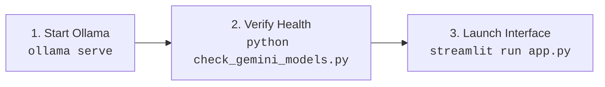

<div align="center">
  
  
  <h1>LegalLens AI</h1>
  
  <p><strong>Autonomous Multi-Agent Legal Assessment & Contract Risk Intelligence Engine</strong></p>

[](https://www.python.org/downloads/)
[](https://ollama.com)
[](https://ollama.com/library/phi3)
[](https://streamlit.io/)
[](https://opensource.org/licenses/MIT)

  <h3>
    <a href="https://youtu.be/bYt8kRoo0A8">🎥 Watch Demo Video</a> •
    <a href="#-prerequisites">📋 Prerequisites</a> •
    <a href="#-quick-start--installation">📦 Installation</a> •
    <a href="#-running-the-application">🚀 Usage</a> •
    <a href="#-high-level-architecture">🏗️ Architecture</a> •
    <a href="#-troubleshooting">🔧 Troubleshooting</a>
  </h3>
</div>

---

> 🔒 **Privacy-First Guarantee**: LegalLens AI performs 100% local inference via Ollama. Confidential legal agreements, proprietary terms, and sensitive client information never leave your local workstation.

---

## 📖 Table of Contents

- [A. Project Overview](#a-project-overview)
  - [Key Features](#key-features)
  - [Tech Stack](#tech-stack)
  - [High-Level Architecture](#high-level-architecture)
- [B. Prerequisites](#b-prerequisites)
  - [System Hardware Requirements](#system-hardware-requirements)
  - [Software & Runtimes](#software--runtimes)
- [C. Clone the Repository](#c-clone-the-repository)
- [D. Environment Configuration](#d-environment-configuration)
  - [Environment Variables Explained](#environment-variables-explained)
  - [Architecture & Port Mapping](#architecture--port-mapping)
- [E. Install Dependencies](#e-install-dependencies)
  - [1. Set Up Python Virtual Environment](#1-set-up-python-virtual-environment)
  - [2. Install Required Dependencies](#2-install-required-dependencies)
- [F. AI/LLM Configuration – Ollama and Gemini API](#f-aillm-configuration--ollama-and-gemini-api)
  - [Option 1: Using Local Ollama (Active Backend)](#option-1-using-local-ollama-active-backend)
  - [Option 2: Using Google Gemini API (Architectural Guide & Limitations)](#option-2-using-google-gemini-api-architectural-guide--limitations)
- [G. Running the Application](#g-running-the-application)
  - [Startup Sequence](#startup-sequence)
  - [Mode 1: Interactive Web Interface (Streamlit)](#mode-1-interactive-web-interface-streamlit)
  - [Mode 2: Single Contract Review (CLI)](#mode-2-single-contract-review-cli)
  - [Mode 3: Batch Processing (CLI)](#mode-3-batch-processing-cli)
- [H. Troubleshooting](#h-troubleshooting)
- [I. Additional Information](#i-additional-information)
  - [Repository Directory Structure](#repository-directory-structure)
  - [Security & Secrets Management](#security--secrets-management)

---

## A. Project Overview

**LegalLens AI** is an automated multi-agent contract review and risk assessment platform designed to eliminate the bottlenecks of manual legal document analysis. By combining specialized LLM agents with deterministic risk rules and enterprise playbook standards, LegalLens AI delivers comprehensive, clause-by-clause contract audits in minutes rather than hours.

### Key Features

- 🦙 **100% Local Inference**: Powered by [Ollama](https://ollama.com) — zero external API keys required, zero data leakage risk, and functional without an active internet connection after model download.
- 🔄 **5-Stage Multi-Agent Pipeline**: Executes contract intake, iterative clause extraction, hybrid risk scoring, playbook compliance comparison, and executive report synthesis.
- ⚡ **Deterministic Risk Rules Matrix**: Enforces objective, mathematical scoring rules (scores 1–10 across Critical, High, Medium, and Low risk thresholds) alongside semantic AI reasoning.
- 📚 **Playbook Compliance Verification**: Compares extracted terms against organizational standards stored in local JSON playbooks (Employment, SaaS, NDA, MSA).
- 💬 **Interactive Contract Q&A Chatbot**: Context-aware chat allowing reviewers to interrogate the parsed contract text and generated findings with cited references.
- 📊 **Dual-Pane Real-Time UI**: Split-screen Streamlit application featuring live PDF viewing, live execution agent traces, markdown report rendering, and one-click DOCX report export.

### Tech Stack

| Component | Technology | Version / Specification | Description |
| :--- | :--- | :--- | :--- |
| **Language Runtime** | Python | 3.10 / 3.11 | Core application programming runtime |
| **LLM Inference Engine** | Ollama REST API | `v0.1.x+` (HTTP port `11434`) | Local model server handling single-turn and streaming chat inference |
| **Default Model** | Microsoft Phi-3 Mini | `phi3:latest` (3.8B params, ~2.2 GB) | High instruction-following & structured JSON output efficiency |
| **Frontend UI** | Streamlit | `1.51.0` (port `8501`) | Reactive split-pane dashboard with session state management |
| **PDF Extraction** | `pdfplumber` / `pypdfium2` | `0.11.8` / `5.0.0` | Precise text, structure, and metadata extraction from PDF contracts |
| **Document Export** | `python-docx` | `1.2.0` | In-memory dynamic conversion from Markdown report to Microsoft Word (`.docx`) |
| **HTTP Client** | `requests` | `2.32.5` | Communicates with Ollama API endpoints (`/api/generate`, `/api/chat`, `/api/tags`) |
| **Playbook Storage** | Static JSON | Flat-file storage (`data/playbooks/`) | Standalone simulated MCP playbook database (no external DB required) |

### High-Level Architecture

<div align="center">
  
  <p><em>Sequential and looping multi-agent pipeline workflow</em></p>
</div>

The system coordinates five specialized pipeline stages:

1. **Stage 1: Contract Intake Agent**
   - Automatically detects contract classification (Employment Agreement, SaaS Agreement, NDA, or Master Services Agreement).
   - Extracts core metadata (signatory parties, effective dates, jurisdiction, and governing law).
   - Assesses document parse quality and structural completeness.
2. **Stage 2: Clause Extraction Agent (Loop Iteration)**
   - Iteratively analyzes the contract section by section (up to 10 iterations).
   - Extracts structured clause entities: non-compete covenants, intellectual property assignment, termination provisions, liability limitations, and payment terms.
3. **Stage 3: Risk Assessment Agent**
   - Evaluates each extracted clause against the built-in risk matrix (`src/tools/risk_matrix.py`).
   - Categorizes risk severity: **CRITICAL** (Score 9–10), **HIGH** (Score 7–8), **MEDIUM** (Score 4–6), and **LOW** (Score 1–3).
4. **Stage 4: Playbook Compliance Agent**
   - Queries standard organizational thresholds from `src/mcp/playbook_server.py`.
   - Identifies deviations between contract terms and approved fallback positions.
5. **Stage 5: Report Generation Agent**
   - Synthesizes findings into a professional legal audit report complete with an Executive Summary, Critical Action Items, Clause Analysis, and Negotiation Recommendations.

---

## B. Prerequisites

Ensure your environment meets the following specifications before installing LegalLens AI:

### System Hardware Requirements

- **RAM**: Minimum 4 GB RAM available (8 GB+ recommended for optimal performance with `phi3:latest`).
- **Disk Space**: At least 5 GB free disk space (to store Ollama models and dependencies).
- **Processor / GPU**: Compatible with modern x86_64 or Apple Silicon CPUs. While GPU acceleration (NVIDIA CUDA / ROCm / Apple Metal) speeds up inference significantly, CPU-only execution is fully supported out of the box.

### Software & Runtimes

1. **Python 3.10 or 3.11**:
   - Verify installation:
     ```bash
     python --version
     ```
   - Download: [python.org/downloads](https://www.python.org/downloads/)
2. **Git**:
   - Download: [git-scm.com](https://git-scm.com/)
3. **Ollama**:
   - Download and install the free local AI runner from [ollama.com/download](https://ollama.com/download).

---

## C. Clone the Repository

Clone the project to your local workstation using Git:

```bash
git clone https://github.com/<your-username>/LegalLens-AI.git
cd LegalLens-AI
```

*(Replace `<your-username>` with your GitHub username or organization name).*

---

## D. Environment Configuration

LegalLens AI uses a `.env` file located in the root project directory to manage local settings.

### Create the Environment File

Copy the template `.env.example` file to create your active `.env` file:

**Windows (Command Prompt):**
```cmd
copy .env.example .env
```

**Windows (PowerShell):**
```powershell
Copy-Item .env.example .env
```

**Linux / macOS:**
```bash
cp .env.example .env
```

### Environment Variables Explained

The configuration is loaded at runtime via `src/config.py` using `python-dotenv`:

| Variable Name | Required? | Default Value | Description |
| :--- | :---: | :--- | :--- |
| `OLLAMA_BASE_URL` | **Yes** | `http://localhost:11434` | The HTTP endpoint where your local Ollama daemon listens. Default is standard for all OSes. |
| `OLLAMA_MODEL` | **Yes** | `phi3:latest` | The model tag used for analysis and interactive chat. Must be pulled in Ollama prior to execution. |
| `OLLAMA_TIMEOUT` | No | `300` | HTTP request timeout in seconds. On CPU-only machines, complex contract clauses may take 2–5 minutes. Increase to `600` if timeouts occur. |

```env
# .env sample configuration
OLLAMA_BASE_URL=http://localhost:11434
OLLAMA_MODEL=phi3:latest
OLLAMA_TIMEOUT=300
```

### Architecture & Port Mapping

- **Streamlit Web Application**: Binds by default to `http://localhost:8501`.
- **Ollama AI Service**: Binds by default to `http://localhost:11434`.
- **Database**: No external database service (such as MongoDB, PostgreSQL, or Redis) is required. Playbooks are loaded directly from local JSON files (`data/playbooks/*.json`).
- **Subprocess Pipeline**: When "Start Analysis" is triggered in the browser, `app.py` launches `run_single.py` as an isolated subprocess, passing unbuffered UTF-8 streams back to the UI in real time.

---

## E. Install Dependencies

All installation commands must be executed from the **root directory of the project** (`LegalLens-AI/`).

### 1. Set Up Python Virtual Environment

Isolate the project packages within a clean virtual environment:

**Windows (PowerShell):**
```powershell
python -m venv .venv
.\.venv\Scripts\Activate.ps1
```

**Windows (Command Prompt):**
```cmd
python -m venv .venv
.venv\Scripts\activate.bat
```

**Linux / macOS:**
```bash
python3 -m venv .venv
source .venv/bin/activate
```

### 2. Install Required Dependencies

Upgrade `pip` and install all pinned production dependencies from `requirements.txt`:

```bash
python -m pip install --upgrade pip
pip install -r requirements.txt
```

*(Optional: If you wish to use the developer utility script `create_test_pdf.py` to generate sample contract PDFs, install `fpdf2` via `pip install fpdf2`).*

---

## F. AI/LLM Configuration – Ollama and Gemini API

### Option 1: Using Local Ollama (Active Backend)

The project currently ships configured for **local, offline inference via Ollama**. Follow these steps to configure and verify your local model:

#### 1. Download & Install Ollama
Download the installer for your operating system:
- **Windows**: [Download Ollama for Windows](https://ollama.com/download/OllamaSetup.exe) and run the installer. It will automatically run as a background service.
- **macOS**: [Download Ollama for Mac](https://ollama.com/download/Ollama-darwin.zip).
- **Linux**: Run `curl -fsSL https://ollama.com/install.sh | sh`.

#### 2. Start the Ollama Service
If the Ollama service is not running automatically:
```bash
ollama serve
```

#### 3. Pull the Expected Model
Download the default model expected by `src/config.py` (`phi3:latest`):
```bash
ollama pull phi3:latest
```

*Alternative lightweight model (for machines with < 4 GB RAM):*
```bash
ollama pull tinyllama:latest
```
*(If pulling `tinyllama:latest`, update `OLLAMA_MODEL=tinyllama:latest` in your `.env` file).*

#### 4. Verify Model Availability
List all downloaded local models:
```bash
ollama list
```
Expected output:
```text
NAME           ID              SIZE      MODIFIED
phi3:latest    4f2222927938    2.2 GB    ...
```

#### 5. Run the Automated Health Check
LegalLens AI includes an automated verification script that validates Ollama connectivity, model availability, and tests live inference:
```bash
python check_gemini_models.py
```
> **Note on Script Naming**: `check_gemini_models.py` is the designated health check utility in the repository root (originally named during early development and preserved for backwards compatibility with test harnesses). It verifies your active Ollama installation.

Expected output:
```text
🦙 Ollama Health Check
   Base URL : http://localhost:11434
   Model    : phi3:latest
--------------------------------------------------
✅ Ollama is running

📦 Installed models:
   • phi3:latest                     2.2 GB ← configured

✅ Configured model 'phi3:latest' is ready

🧪 Running quick inference test...
   Model response: 'OK'

✅ LegalLens-AI is ready to run!
   Start with: streamlit run app.py
```

---

### Option 2: Using Google Gemini API (Architectural Guide & Limitations)

> [!IMPORTANT]
> **Current Architectural Limitation**: LegalLens AI was migrated from Google Gemini / Google ADK to local Ollama. **Gemini API is NOT currently implemented in the active codebase.** Simply adding an API key to `.env` will **NOT** route requests to Gemini.
> 
> All agent pipelines (`src/agent.py`), HTTP clients (`src/ollama_client.py`), and chat components (`app.py`) currently send requests to Ollama's REST endpoints. Re-enabling Gemini requires an application-code change.

If you or your team wish to contribute or re-enable Google Gemini API integration, follow this architecture reference:

#### 1. Obtain a Gemini API Key
1. Navigate to the official Google AI Studio key generator: [https://aistudio.google.com/app/apikey](https://aistudio.google.com/app/apikey).
2. Sign in with your Google account.
3. Click **"Create API key"** and copy the generated secret key string.

#### 2. Expected Environment Variable
In standard Gemini implementations, the variable name must be:
```env
GOOGLE_API_KEY=AIzaSyYourActualSecretKeyHere
```

#### 3. Required Application Code Changes to Support Gemini
To transition the application from Ollama back to Google Gemini, the following codebase updates are required:
1. **Dependencies (`requirements.txt`)**:
   Add the official Google GenAI SDK:
   ```text
   google-genai>=1.0.0
   ```
2. **Configuration (`src/config.py`)**:
   Restore reading the Google API Key and target Gemini model:
   ```python
   GOOGLE_API_KEY = os.getenv("GOOGLE_API_KEY")
   GEMINI_MODEL = os.getenv("GEMINI_MODEL", "gemini-1.5-flash")
   ```
3. **Agent & Chat Client Adapter (`src/ollama_client.py` or new `src/gemini_client.py`)**:
   Implement a backend switch in the generation functions (`generate()`, `chat_stream()`) to route requests through `google.genai.Client(api_key=GOOGLE_API_KEY)` when a cloud provider flag is toggled.

---

## G. Running the Application

### Startup Sequence

Always start the services in the following order:



### Mode 1: Interactive Web Interface (Streamlit)

This is the primary user interface providing split-screen contract analysis, real-time agent tracing, and interactive Q&A.

1. Ensure Ollama is running and your virtual environment is active.
2. Launch the Streamlit server from the project root:
   ```bash
   streamlit run app.py
   ```
3. The terminal will output:
   ```text
     You can now view your Streamlit app in your browser.
     Local URL: http://localhost:8501
   ```
4. Open **`http://localhost:8501`** in your web browser.
5. **How to Use**:
   - Drag and drop any contract PDF into the left pane (or test with `input_contracts/test_employment.pdf`).
   - Click the green **"🚀 Start Analysis"** button.
   - Monitor the agent execution stages and progress bars in real time.
   - Read the structured report, download it as `.docx`, or ask questions in the **"💬 Chat with your Contract"** interface.

---

### Mode 2: Single Contract Review (CLI)

To evaluate a contract directly from your terminal and output the markdown report:

```bash
python run_single.py input_contracts/test_employment.pdf
```

The script parses the PDF, invokes the 5-stage agent workflow, and prints the synthesized audit report directly to stdout.

---

### Mode 3: Batch Processing (CLI)

To process an entire portfolio of contracts automatically:

1. Copy your contract PDF files into the `input_contracts/` folder:
   ```bash
   # Example: copy files into input_contracts
   cp /path/to/contracts/*.pdf input_contracts/
   ```
2. Run the batch processor:
   ```bash
   python run_batch.py
   ```
3. The processor iterates through each PDF in `input_contracts/`, runs the multi-agent pipeline, and outputs sequential audit reports.

---

## H. Troubleshooting

### 1. "Cannot connect to Ollama at http://localhost:11434"
- **Cause**: The Ollama background service is not running or is blocked by local firewall rules.
- **Solution**:
  - Open a terminal and run `ollama serve`.
  - On Windows, ensure Ollama is visible and running in your System Tray.
  - Verify accessibility by navigating to `http://localhost:11434/` in your browser (you should see `"Ollama is running"`).

### 2. "Model 'phi3:latest' is not downloaded"
- **Cause**: The specified model has not been pulled to your local machine.
- **Solution**:
  ```bash
  ollama pull phi3:latest
  ```
  Run `ollama list` to verify that `phi3:latest` appears in the list.

### 3. Analysis Times Out or Generates Slowly on CPU
- **Cause**: LLM inference on multi-page contracts running on CPU hardware requires several minutes per pipeline stage.
- **Solution**:
  - Open `.env` and increase the timeout value:
    ```env
    OLLAMA_TIMEOUT=600
    ```
  - Switch to a smaller, faster model:
    ```bash
    ollama pull tinyllama:latest
    ```
    And update `.env`:
    ```env
    OLLAMA_MODEL=tinyllama:latest
    ```

### 4. "UnicodeEncodeError: 'charmap' codec can't encode character" on Windows
- **Cause**: Windows command prompt defaults to legacy code pages (e.g. `cp1252`), failing on emojis or legal symbols.
- **Solution**:
  Set UTF-8 mode in your environment:
  ```cmd
  set PYTHONUTF8=1
  set PYTHONIOENCODING=utf-8
  ```
  *(Note: `app.py` automatically injects `PYTHONUTF8=1` into subprocess runs).*

### 5. Streamlit Port Conflict (Port 8501 In Use)
- **Cause**: Another service or prior Streamlit instance is occupying port `8501`.
- **Solution**:
  Specify an alternate port when starting the app:
  ```bash
  streamlit run app.py --server.port 8502
  ```

### 6. "No module named 'fpdf'" when Running `create_test_pdf.py`
- **Cause**: The optional test script `create_test_pdf.py` requires `fpdf2`, which is a developer utility not strictly required for the core application.
- **Solution**:
  ```bash
  pip install fpdf2
  ```

### 7. Virtual Environment Access Denied / Invalid Python Path
- **Cause**: A moved or corrupted `.venv` referencing a deleted Python installation path.
- **Solution**:
  Delete and recreate the virtual environment:
  ```powershell
  Remove-Item -Recurse -Force .venv
  python -m venv .venv
  .\.venv\Scripts\activate
  pip install -r requirements.txt
  ```

---

## I. Additional Information

### Repository Directory Structure

```text
LegalLens-AI/
├── .env.example                    # Template environment configuration
├── .gitignore                      # Git ignore manifest (excludes .env, .venv, caches)
├── README.md                       # Comprehensive project documentation
├── requirements.txt                # Pinned Python dependencies
├── app.py                          # Streamlit dual-pane interactive web application
├── run_single.py                   # CLI runner for analyzing a single contract PDF
├── run_batch.py                    # CLI batch processor for analyzing all PDFs in input_contracts/
├── check_gemini_models.py          # Automated Ollama connectivity & inference health check
├── create_test_pdf.py              # Developer utility to generate synthetic test contracts
│
├── data/
│   ├── figures/                    # UI branding, logo, and architecture diagrams
│   │   ├── LEGAL LENSE AI.png
│   │   └── architecture_diagram.png
│   └── playbooks/                  # Local JSON compliance playbooks (simulated MCP server)
│       ├── employment_agreement.json
│       ├── msa.json
│       ├── nda.json
│       └── saas_agreement.json
│
├── input_contracts/                # Directory for placing test PDF files (includes test_employment.pdf)
│   └── test_employment.pdf
│
└── src/
    ├── __init__.py
    ├── agent.py                    # 5-stage sequential and looping multi-agent pipeline
    ├── config.py                   # Centralized configuration and environment loader
    ├── ollama_client.py            # Ollama REST API client (single-turn, chat, and stream)
    │
    ├── mcp/
    │   ├── __init__.py
    │   └── playbook_server.py      # Playbook lookup and contract term standard evaluation
    │
    ├── tools/
    │   ├── __init__.py
    │   ├── pdf_parser.py           # Extracts clean text, pages, and headers via pdfplumber
    │   └── risk_matrix.py          # Deterministic risk evaluation rules and scoring matrix
    │
    └── utils/
        └── docx_generator.py       # Converts markdown report into formatted Word (.docx) document
```

### Security & Secrets Management

- **Zero Data Ingestion Risk**: No contract data, extracted text, or analysis reports are ever transmitted outside your local machine.
- **Do Not Commit `.env`**: Always ensure that `.env` is listed in your `.gitignore` file before pushing code to any public or private GitHub repository.
- **Clean Clones**: Never commit API keys, personal credentials, or local environment paths to version control.

---

## 📄 License

This project is licensed under the **MIT License** — see the [LICENSE](LICENSE) file for details.

---

## 🙏 Acknowledgments

- **[Ollama](https://ollama.com)** for enabling seamless, performant local LLM inference.
- **[Microsoft Phi-3](https://ollama.com/library/phi3)** for exceptional reasoning and JSON formatting in an ultra-compact model.
- **[Streamlit](https://streamlit.io)** for empowering rapid and elegant Python web interface creation.
- **[pdfplumber](https://github.com/jsvine/pdfplumber)** for dependable legal document text extraction.
